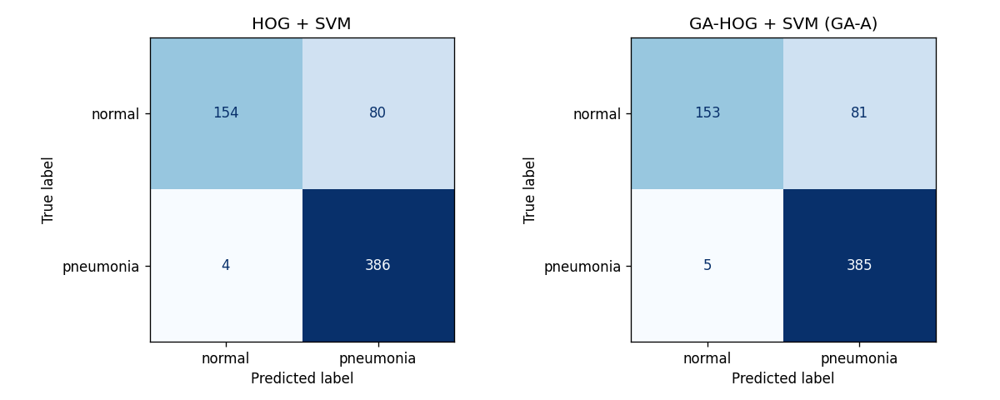
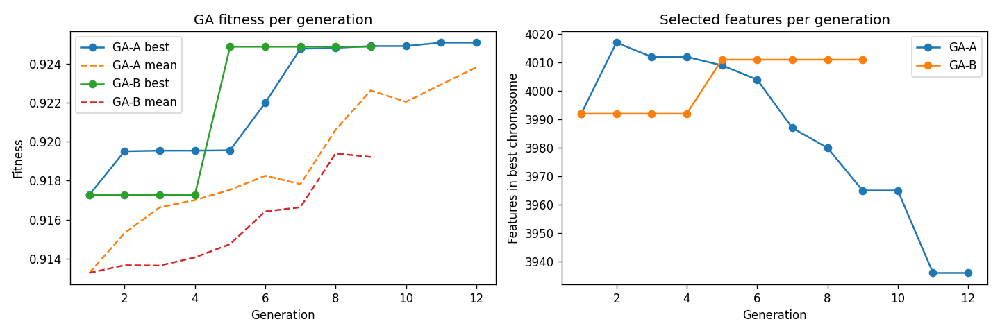
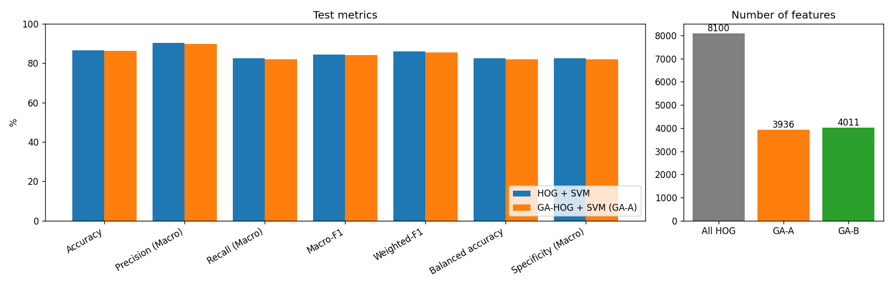

# Lab 07: Improving HOG-Based Medical Image Classification Using a Genetic Algorithm

**Course:** Introduction to Computer Vision (ICV) · **Notebook:** `ICV_BAI_032_LAB7.ipynb` (runs in Google Colab, CPU runtime)

## Objective

Add a Genetic Algorithm (GA) for feature selection to the standard HOG + SVM pipeline, and test whether it improves classification of chest X-rays while using fewer features.

**Research question:** Can GA-based feature selection improve the classification performance of HOG features while reducing feature dimensionality on medical images?

The hypothesis is tested, not assumed. If the GA does not help, the notebook reports that.

## Method in brief

**HOG (Histogram of Oriented Gradients).** The image is divided into 8×8-pixel cells. Each cell gets a 9-bin histogram of gradient directions, weighted by gradient strength. Neighbouring cells are grouped into 2×2 blocks and normalised (L2-Hys) so the descriptor is less sensitive to brightness and contrast. For a 128×128 image this gives 15 × 15 blocks × 4 cells × 9 bins = **8100 features**.

**GA feature selection.** Each chromosome is a binary mask of length 8100: gene *i* = 1 means HOG feature *i* is kept. The GA evolves a population of masks:

| Step | Choice |
|---|---|
| Initial population | Each gene set to 1 with probability 0.5 |
| Fitness | `validation macro-F1 − 0.05 × (fraction of features kept)` |
| Fitness classifier | RBF-SVM (C from the baseline), trained on a fixed stratified subset of 600 training images and scored on the full validation set |
| Selection | Tournament, size 3 |
| Crossover | Uniform, probability 0.8 |
| Mutation | Bit-flip with probability `p_m` per gene |
| Elitism | Best 2 masks copied to the next generation |
| Stopping | 12 generations, or 4 generations without improvement |

Macro-F1 is used because the dataset is imbalanced. The small penalty term favours smaller masks when two masks score about the same.

Two GA settings are compared (only the mutation probability changes):

| Setting | Population | Mutation probability |
|---|---|---|
| GA-A | 12 | 0.01 |
| GA-B | 12 | 0.05 |

## Dataset

**PneumoniaMNIST** (MedMNIST v2 / MedMNIST+, 128×128 version). Grayscale paediatric chest X-rays from Kermany et al. (2018), labelled `0 = normal` and `1 = pneumonia`. Licence: CC BY 4.0.

| Split | Images | Normal | Pneumonia |
|---|---|---|---|
| Train | 4708 | 1214 | 3494 |
| Validation | 524 | 135 | 389 |
| Test | 624 | 234 | 390 |

(The notebook prints these counts when it loads the data.)

The notebook downloads the dataset automatically with the `medmnist` package into `data/` (about 80 MB). If the download fails, get `pneumoniamnist_128.npz` from [Zenodo](https://zenodo.org/records/10519652) and upload it to `data/` in Colab.

The dataset is **not** stored in this repository (`data/` is in `.gitignore`).

## Experimental protocol

- **Fixed split:** the official MedMNIST train/validation/test split, the same for every model.
- **Fixed seed:** `SEED = 42` for NumPy, the GA and the fitness subset.
- **Preprocessing:** grayscale, 128×128, scaled to [0, 1]. A `StandardScaler` is fitted on the training set only.
- **Classifier:** the same for both models: RBF-SVM, `gamma='scale'`, `class_weight='balanced'`. C is chosen from {1, 10, 100} by validation macro-F1.
- **No test leakage:** GA fitness, choosing the best chromosome, choosing between GA-A and GA-B (higher validation macro-F1, fewer features if tied), and tuning C all use the training and validation sets only. The test set is used once, in the final evaluation.
- **Caching:** the best mask from each GA run is saved in `results/`. With `RERUN_GA = False`, re-running the notebook reuses the saved masks.

| Parameter | Baseline: HOG + SVM | Proposed: GA-HOG + SVM |
|---|---|---|
| Medical dataset | PneumoniaMNIST | PneumoniaMNIST |
| Image resolution | 128 × 128 | 128 × 128 |
| HOG orientations | 9 | 9 |
| Pixels per cell | 8×8 | 8×8 |
| Cells per block | 2×2 | 2×2 |
| Block normalization | L2-Hys | L2-Hys |
| Feature selection | None | Genetic Algorithm |
| Classifier / kernel | SVM / RBF | SVM / RBF |
| Hyperparameter tuning | Validation set | Validation set |
| Data split | Identical fixed split | Identical fixed split |
| Random seed | 42 | 42 |

## Evaluation metrics

Accuracy, macro precision, macro recall, macro-F1, weighted-F1, balanced accuracy, macro specificity (one-vs-rest TN / (TN + FP) per class, then averaged), Cohen's kappa, Matthews correlation coefficient and confusion matrices. The notebook also reports the number and percentage of features kept, and timings for HOG extraction, GA search, SVM training and inference.

## Results

All numbers below come from one full run of the notebook on a free Colab CPU (seed 42). The tables are saved in `results/` and the plots in `figures/`.

### Validation (used for every decision)

| Model | Features kept | Validation macro-F1 | Chosen C |
|---|---|---|---|
| HOG + SVM (baseline) | 8100 (100%) | 0.9553 | 1 |
| GA-A (p_m = 0.01, ran 12 generations) | 3936 (48.6%) | **0.9605** | 1 |
| GA-B (p_m = 0.05, stopped early at generation 9) | 4011 (49.5%) | 0.9520 | 10 |

On validation, GA-A scored highest, so it was chosen as the proposed model before the test set was used.

### Test set (Table 2, `results/table2_test_comparison.csv`)

| Metric | HOG + SVM (Baseline) | GA-HOG + SVM (GA-A) | Improvement |
|---|---|---|---|
| Accuracy (%) | 86.54 | 86.22 | −0.32 |
| Precision (Macro, %) | 90.15 | 89.73 | −0.42 |
| Recall (Macro, %) | 82.39 | 82.05 | −0.34 |
| Macro-F1 (%) | 84.38 | 84.01 | −0.37 |
| Weighted-F1 (%) | 85.83 | 85.49 | −0.34 |
| Balanced accuracy (%) | 82.39 | 82.05 | −0.34 |
| Specificity (Macro, %) | 82.39 | 82.05 | −0.34 |
| Cohen's kappa | 0.69 | 0.69 | −0.01 |
| Matthews correlation coefficient | 0.72 | 0.71 | −0.01 |

For reference only (not used for any decision): GA-B reached 81.01% test macro-F1 and 84.13% accuracy.

**Confusion matrices (test).** The baseline gets 154/234 normal and 386/390 pneumonia right. GA-A gets 153/234 and 385/390. The two models differ by only two test images (one per class). Both models make the same kind of mistake: about a third of normal X-rays (80–81 of 234) are predicted as pneumonia.



### Feature reduction and computational cost (`results/computational_cost.csv`)

| | HOG + SVM | GA-HOG + SVM (GA-A) |
|---|---|---|
| Features | 8100 | 3936 (48.6%) |
| HOG extraction, all 5856 images (shared) | 49.1 s | 49.1 s |
| GA search | — | 244 s (4.1 min) |
| C tuning (3 SVM fits) | 179.6 s | 85.8 s |
| SVM training, chosen C | 50.6 s | 24.7 s |
| Test inference (624 images) | 9.9 s | 5.2 s |





### Conclusion

On this dataset, GA feature selection **did not improve classification**. GA-HOG + SVM kept 48.6% of the HOG features and scored 0.3–0.4 percentage points lower than the baseline on every test metric. That is a difference of two images out of 624, which is within what one split and one seed can show as noise. The two models perform about the same.

The GA did deliver a **dimensionality reduction with about the same accuracy**. With half the features, the final SVM trained about 2× faster (50.6 s → 24.7 s) and predicted about 2× faster (9.9 s → 5.2 s). The price is a one-time GA search of about 4 minutes.

On validation, GA-A looked better than the baseline (0.9605 vs 0.9553 macro-F1), but this did not carry over to the test set. This is the expected effect of selecting features on the same validation set used to score them. It shows why the test set had to stay untouched until the end.

Mutation probability mattered. GA-A (0.01) kept improving and removing features until the last generation. GA-B (0.05) found one good mask early, then made no progress and stopped at generation 9. Its mask was worse on validation and on test.

Both models score much lower on test (about 84% macro-F1) than on validation (about 95%). The test set has a different class balance (234 : 390 vs 135 : 389), and most errors are normal X-rays predicted as pneumonia. This gap comes from the dataset and the HOG features themselves, not from the GA.

## How to run

**Google Colab (recommended)**

1. Open `ICV_BAI_032_LAB7.ipynb` in Colab (File → Upload notebook, or open it from GitHub).
2. Keep the default CPU runtime.
3. Runtime → Run all. The first cell installs `medmnist`; everything else is already in Colab.
4. Download `results/` and `figures/` from the Colab file browser if you want to keep them.

Measured on a free Colab CPU: download about 1 min, HOG about 1 min, baseline tuning about 3 min, the two GA runs about 7 min, GA-model tuning about 4 min. The whole notebook takes roughly 20 minutes.

Later runs reuse the saved masks if `results/` is still there.

**Locally**

```bash
pip install -r requirements.txt
jupyter notebook ICV_BAI_032_LAB7.ipynb
```

## Repository structure

```
Lab_07/
├── ICV_BAI_032_LAB7.ipynb     # full experiment
├── README.md
├── requirements.txt
├── .gitignore
├── results/                   # created by the notebook: CSV tables, GA masks and histories
└── figures/                   # created by the notebook: plots
```

## Limitations

- **Optimistic validation score.** GA fitness and the choice of the best mask use the same validation set, so the GA model's validation score is optimistic. Only the test results are a fair comparison.
- **Fitness on a subset.** To keep Colab runtime reasonable, fitness uses an SVM trained on 600 of the 4708 training images, so the chosen mask may not be the best one for the full training set.
- **Small search.** A population of 12 and up to 12 generations explores only a small part of the 2^8100 possible masks. The initial masks keep about half of the features, so the final mask also keeps a large fraction.
- **One split, one seed.** There are no confidence intervals, so differences of about one percentage point may be noise.
- **No patient IDs.** MedMNIST does not include patient identifiers, so patient-level separation between splits cannot be verified. The experiment relies on the official split.
- **Low resolution.** 128×128 images lose fine detail compared with the original X-rays.

## Reproducibility

- Seed 42 everywhere; the official fixed split; HOG and GA settings defined in one place near the top of the notebook.
- The scaler and all model decisions use only train and validation data.
- Saved GA masks (`results/GA-*_best_mask.npy`) let the final models be rebuilt without re-running the GA.

## References

- Dalal, N., & Triggs, B. (2005). Histograms of Oriented Gradients for Human Detection. *CVPR*.
- Yang, J., et al. (2023). MedMNIST v2: A large-scale lightweight benchmark for 2D and 3D biomedical image classification. *Scientific Data*, 10, 41.
- Kermany, D. S., et al. (2018). Identifying Medical Diagnoses and Treatable Diseases by Image-Based Deep Learning. *Cell*, 172(5), 1122–1131.
- Holland, J. H. (1975). *Adaptation in Natural and Artificial Systems*. University of Michigan Press.
