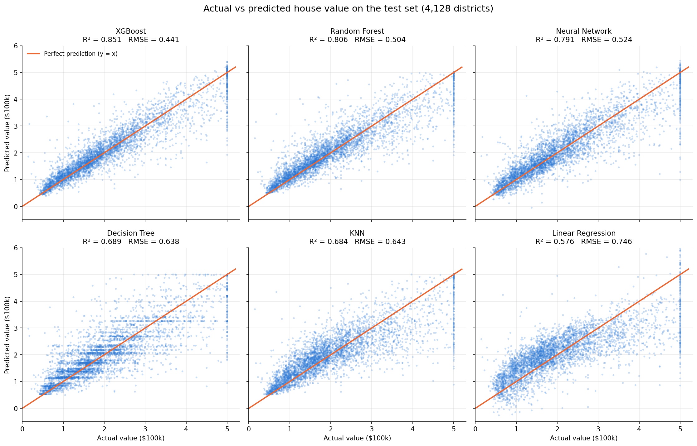
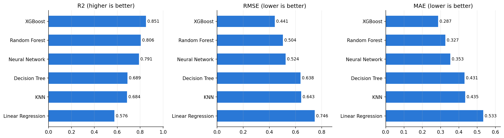
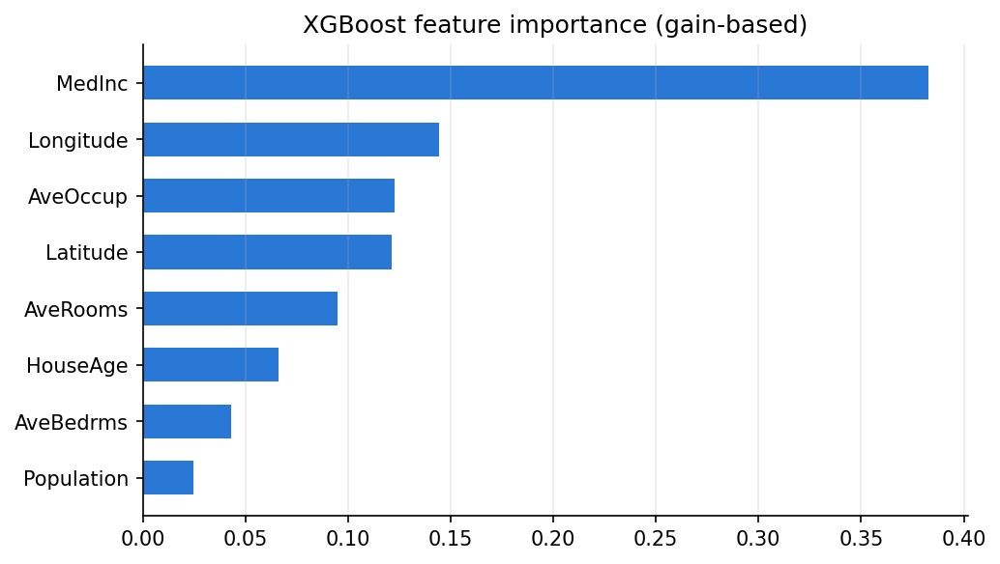

# Comparative Implementation of Machine Learning Regression Algorithms

[](https://colab.research.google.com/github/alisherahmad/ml-regression-comparison/blob/main/Regression_Comparison.ipynb)

Six regression algorithms are trained on the same house-price prediction problem and compared fairly:
**Linear Regression, Decision Tree, Random Forest, Neural Network (MLP), XGBoost and K-Nearest Neighbors.**

**Result:** XGBoost performs best, with R² = 0.851 and RMSE = 0.441 (about $44,100) on the test set.

## Dataset

[California Housing](https://scikit-learn.org/stable/modules/generated/sklearn.datasets.fetch_california_housing.html) (1990 U.S. census), loaded directly with scikit-learn, so you don't need to download anything.

- 20,640 districts, 8 numeric features, no missing values
- **Features:** `MedInc`, `HouseAge`, `AveRooms`, `AveBedrms`, `Population`, `AveOccup`, `Latitude`, `Longitude`
- **Target:** `MedHouseVal`, the median house value in units of $100,000

## Method

All six models use the **same features, target, 80:20 train/test split (`random_state=42`) and metrics**.

1. **Split:** 16,512 training rows, 4,128 test rows
2. **Scaling:** `StandardScaler` is fitted on the training set only. Scaled features go to Linear Regression, the Neural Network and KNN. The tree-based models use raw features, because scaling doesn't change threshold splits.
3. **Models:**

| Model | Key settings |
| --- | --- |
| Linear Regression | OLS |
| Decision Tree | `max_depth=10`, `min_samples_leaf=5` |
| Random Forest | 200 trees |
| Neural Network | `MLPRegressor`, hidden layers (64, 32), ReLU, Adam, early stopping |
| XGBoost | 600 trees, `learning_rate=0.05`, `max_depth=6`, `subsample=0.8`, `colsample_bytree=0.8` |
| KNN | `k=11` (chosen by 5-fold CV), distance-weighted |

4. **Metrics:** MAE, MSE, RMSE, R², plus 5-fold cross-validation R² on the training set as a robustness check

## Results

| Rank | Model | MAE | MSE | RMSE | R² |
| --- | --- | --- | --- | --- | --- |
| 1 | **XGBoost** | **0.2870** | **0.1948** | **0.4414** | **0.8513** |
| 2 | Random Forest | 0.3268 | 0.2543 | 0.5043 | 0.8059 |
| 3 | Neural Network | 0.3533 | 0.2745 | 0.5239 | 0.7905 |
| 4 | Decision Tree | 0.4311 | 0.4071 | 0.6380 | 0.6893 |
| 5 | KNN | 0.4351 | 0.4136 | 0.6431 | 0.6844 |
| 6 | Linear Regression | 0.5332 | 0.5559 | 0.7456 | 0.5758 |

Cross-validation gives the same ranking. XGBoost's CV R² is 0.848 ± 0.004.

### Actual vs predicted



### Metric comparison



### Feature importance (XGBoost)



## Why XGBoost wins

House value depends on income and location in a non-linear way, with interactions between features. A straight line can't capture that. Each boosting round fits a small tree to the errors left by the previous rounds, so XGBoost keeps correcting exactly where earlier trees were wrong. Its learning rate, subsampling and L2 regularisation keep it from overfitting: the gap between its training and test R² is smaller than Random Forest's.

| Algorithm | Strength | Limitation |
| --- | --- | --- |
| Linear Regression | Fast, interpretable | Can't model non-linearity; extrapolates badly on outliers |
| Decision Tree | Non-linear, easy to explain | High variance; step-shaped predictions |
| Random Forest | Robust, low variance | Slower and larger in memory |
| Neural Network | Flexible function approximator | Needs scaling and tuning; a black box |
| XGBoost | Most accurate, regularised, fast | Many hyperparameters |
| KNN | Simple, no training phase | Needs scaling; slow predictions on large data; sensitive to k |

## How to run

**Google Colab (easiest):** click the **Open in Colab** badge above, then choose *Runtime → Run all*. It takes about 2 minutes.

**Locally:**

```bash
git clone https://github.com/alisherahmad/ml-regression-comparison.git
cd ml-regression-comparison
pip install -r requirements.txt
jupyter notebook Regression_Comparison.ipynb
```

## Repository structure

```
ml-regression-comparison/
├── Regression_Comparison.ipynb   # full code with outputs
├── images/                       # plots generated by the notebook
├── requirements.txt
└── README.md
```

## Author

Ali Sher Ahmad, BS Artificial Intelligence, COMSATS University Islamabad, Wah Campus

